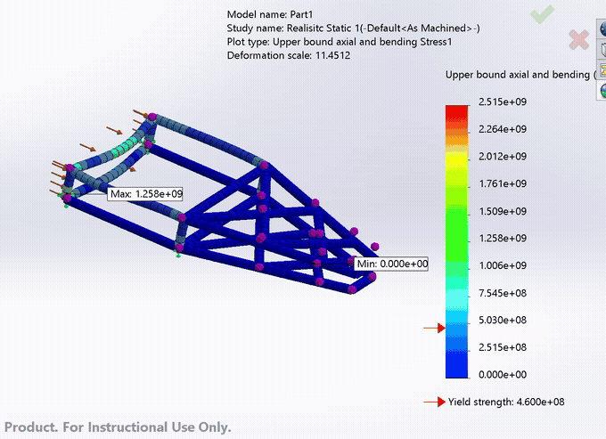
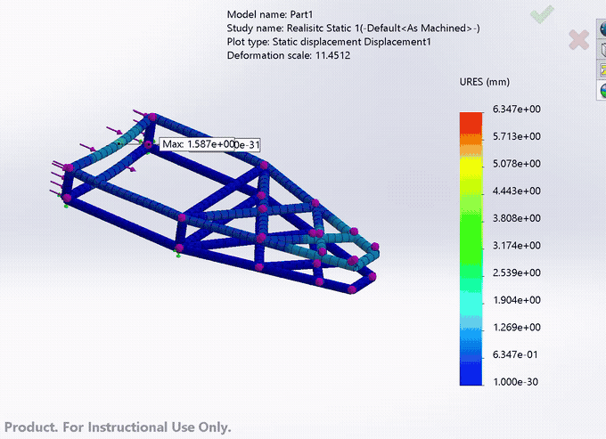
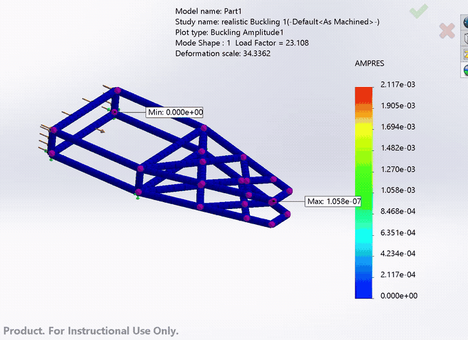
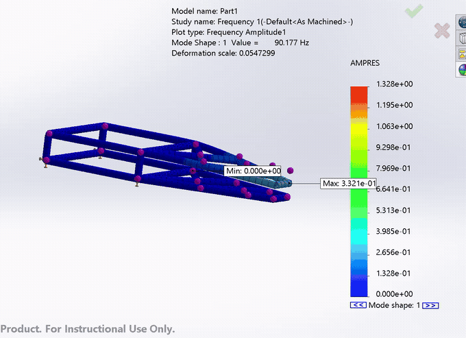
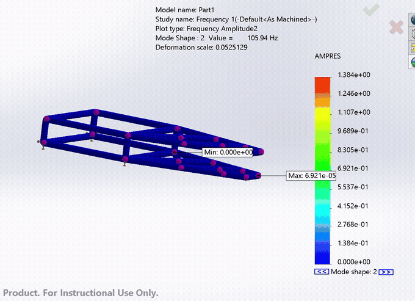
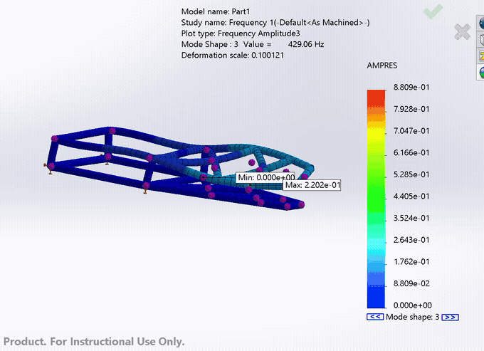
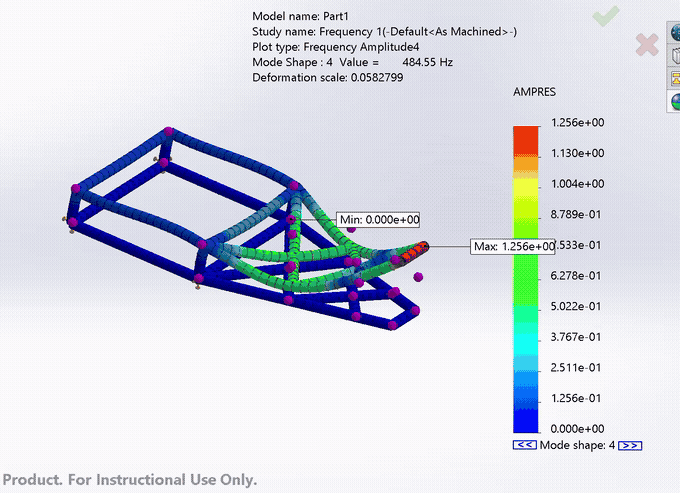

# Battle Bot Frame: Structural FEA

**Software:** SolidWorks Weldments, SolidWorks Simulation · **Type:** Final project (simulation learning) · **Date:** April 2025

## Overview
A tubular space frame (chassis) for a combat robot, modeled as a SolidWorks weldment and analyzed with beam elements for static strength, buckling and vibration.

The goal of this project was to **learn the FEA workflow**, not to deliver a finished design: setting up fixtures and loads, running different study types, and reading the results. I estimated the loads from published combat robot data, so they're approximations rather than measured values.

## Analyses
I ran several studies: Static 1, 2 and 5, Buckling 1 and 2, and "realistic" versions of the static and buckling cases. The results below are from the realistic load case and the frequency study.

| Study | Result |
|---|---|
| Static: max stress (upper bound axial + bending) | 2,515 MPa (yield: 460 MPa) |
| Static: max displacement | 6.35 mm |
| Buckling: first mode load factor | **23.1** (the frame would buckle at about 23× the applied load) |
| Frequency: mode 1 | 90.2 Hz |
| Frequency: mode 2 | 105.9 Hz |
| Frequency: mode 3 | 429.1 Hz |
| Frequency: mode 4 | 484.6 Hz |

**Reading the stress result:** the peak stress is about 5.5× the material's yield strength, a safety factor of about 0.18. Under this estimated impact load, the bumper tubes at the loaded end would yield. The frame as modeled would need reinforcement there, such as larger or thicker tubes or extra bracing, before it could survive this load. The rest of the frame stays well below yield.

## Results

### Static stress and displacement
Loads are applied to the wide end of the frame. Peak stress is in the curved tubes at that end. The triangulated section stays at low stress.

| Stress | Displacement |
|---|---|
|  |  |

### Buckling
The first buckling mode has a load factor of 23.1. The narrow, tapered end of the frame deflects most in this mode.

### Natural frequencies
The first two modes (90 and 106 Hz) are local modes of the narrow, tapered end of the frame. The higher modes are above 400 Hz.

| Mode 1: 90.2 Hz | Mode 2: 105.9 Hz |
|---|---|
|  |  |
| **Mode 3: 429.1 Hz** | **Mode 4: 484.6 Hz** |
|  |  |

## What this project shows
- Building a frame with SolidWorks Weldments and meshing it with beam elements
- Running and comparing static, buckling and frequency studies, including multiple load cases
- Reading results against a failure criterion: finding where the design fails and what would need to change

## Limitations
- The loads are estimates from online data, not measured impact forces.
- The static studies are linear and use a steady load in place of a dynamic impact. A drop test or explicit dynamics study would model a real hit more accurately.

## Files
The original SolidWorks files are no longer available. The full-resolution result videos are in [`docs/fea-videos/`](docs/fea-videos).
